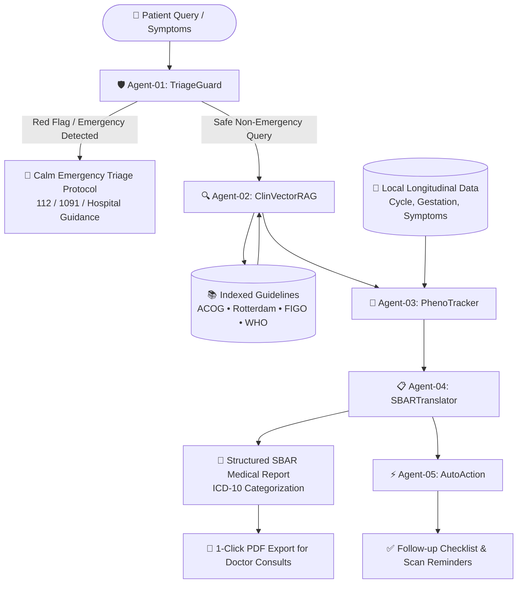

# 🌸 Arogini (HerVita)

> **Autonomous Multi-Agent Clinical AI Copilot & Longitudinal Reproductive Health Platform for Women**  
> *Grounded in ACOG, Rotterdam PCOS, FIGO & WHO Clinical Guidelines • 100% Client-Side Privacy*

---

[](https://opensource.org/licenses/MIT)
[](https://nodejs.org/)
[](#-privacy-first-architecture)
[](#-clinical-guidelines-grounding)
[](https://github.com/yadnimali12)

---

## 📌 Executive Summary & Clinical Mission

In India and many parts of the world, women face significant social stigma, medical dismissal, and an articulation gap when seeking care for reproductive, menstrual, and obstetric concerns. A typical clinical consultation lasts less than 5 to 7 minutes, leaving patients overwhelmed and unable to convey chronologically structured symptom patterns.

**Arogini** bridges this gap. It is an agentic healthcare web platform designed to empower women with:
1. **Clinical Literacy**: Evidence-backed anatomical education, organ care tips, and plain-language definitions.
2. **Longitudinal Phenotyping**: Objective tracking of cycles, PCOS markers, pregnancy gestational milestones, and pelvic pain.
3. **Multi-Agent Clinical AI**: An offline-capable 5-agent swarm that retrieves international guidelines (ACOG, Rotterdam, FIGO, WHO), verifies safety boundaries, and translates subjective symptoms into standardized doctor-ready **SBAR** medical reports.
4. **100% Device-Only Privacy**: Zero cloud profiling, zero telemetry, and complete patient data ownership stored exclusively on the user's browser.

> ⚠️ **Medical Boundary Disclaimer:**  
> Arogini informs, organizes, and empowers communication. It does **not** provide a definitive medical diagnosis and does **not** replace a licensed physician or obstetrician.

---

## 🏗️ Multi-Agent Swarm Architecture

Arogini employs an autonomous multi-agent pipeline that processes user queries through sequential safety checks, semantic guideline retrieval, and clinical documentation synthesis:



### The 5 Specialized Clinical Agents:

| Agent | Name | Responsibility | Clinical Grounding |
| :--- | :--- | :--- | :--- |
| **Agent-01** | `TriageGuard` | Screens for acute red flags (e.g. preeclampsia warning signs, ectopic pregnancy pain, severe hemorrhage) and triggers calm emergency protocols. | ACOG Practice Bulletin #222 & Emergency Triage Guidelines |
| **Agent-02** | `ClinVectorRAG` | Performs semantic retrieval across 28+ curated clinical guideline vectors to ground answers in peer-reviewed evidence. | ACOG, Rotterdam PCOS 2018/2023, FIGO PALM-COEIN, WHO ANC |
| **Agent-03** | `PhenoTracker` | Correlates user queries with the patient's specific menstrual phase, gestational week, or postpartum timeline. | FIGO Menstrual Disorders & WHO Pregnancy Milestones |
| **Agent-04** | `SBARTranslator` | Converts colloquial patient language into structured **SBAR** (Situation, Background, Assessment, Recommendation) for clinical handover. | Institute for Healthcare Improvement (IHI) SBAR Standard |
| **Agent-05** | `AutoAction` | Automatically identifies actionable doctor recommendations, diagnostic blood tests, and ultrasound scans into a checkable list. | Standard Prenatal & Gynecological Care Bundles |

---

## 🌟 Key Platform Modules

### 1. 🤖 Agentic AI & Vector RAG Hub
- Real-time conversational copilot with local, zero-latency vector retrieval.
- Speech-to-Text voice query support.
- Pre-built clinical scenario prompts (Preeclampsia at Week 32, Rotterdam PCOS assessment, Debilitating Dysmenorrhea, Postpartum Depression).

### 2. 🤰 Obstetrics Care Suite
- **Gestational Calculator**: Calculates exact weeks and days based on LMP with estimated delivery date (EDD).
- **Trimester Navigation**: Personalized milestone cards and developmental highlights across Weeks 1 to 40.
- **WHO Antenatal Care (ANC) Tracker**: Tracks the 8 recommended contact points, blood pressure trends, and urine tests.
- **Fetal Kick Counter**: Integrated timer and one-tap kick logger with movement frequency analysis.

### 3. 🔬 Gynecology & PCOS Phenotyping
- **Menstrual Cycle Diary**: Period duration, flow intensity, and cycle variation tracking.
- **Rotterdam PCOS Phenotyping**: Logs hyperandrogenism markers (hirsutism, hormonal acne), ovulatory dysfunction, and ultrasound morphology.
- **Pelvic Pain & Dysmenorrhea Diary**: Multi-point severity rating, functional life impact (work, school, sleep), and pain radiation mapping.

### 4. 📋 Doctor Visit Summary & 1-Click PDF SBAR Synthesis
- Automatically compiles active symptoms, logged pain episodes, and cycle regularity into an objective medical report.
- Formatted in accordance with the hospital-standard **SBAR framework**:
  - **S (Situation)**: Primary presenting complaint and symptom duration.
  - **B (Background)**: Obstetric history, cycle length, and baseline medications.
  - **A (Assessment)**: Functional impact, severity distribution, and red-flag screening results.
  - **R (Recommendation)**: Evidence-based questions prepared for the physician.
- **Direct 1-Click PDF Download** powered by `html2pdf.js` for instant physical or digital sharing during clinic visits.

### 5. 💉 Vaccines & Immunization Records
- Clinical guidelines and dose trackers for:
  - **HPV (Human Papillomavirus)**: 2-dose adolescent and catch-up schedules for cervical cancer prevention.
  - **Tdap (Tetanus, Diphtheria, Pertussis)**: Third-trimester administration (Weeks 27–36) for passive neonatal immunity.
  - **MMR & Varicella**: Pre-conception immunity screening.
  - **Influenza**: Seasonal maternal protection.

### 6. 🧠 Interactive Anatomical Atlas & Education
- Interactive visual explorer covering the 7 key organs of the female reproductive system:
  - *Uterus, Ovaries, Fallopian Tubes, Cervix, Vagina, Pelvic Floor, and Breasts*.
- Evidence-based care tips covering nutrition, warmth, hydration, gentle movement, and signs requiring clinical review.
- Clinician-approved video library with curated explainer modules.

### 7. 👤 User Authentication & Sliding Profile Drawer
- **Client-Side Session Auth**: Secure, private login and registration with remember-me support.
- **Right Sliding Profile Panel**: Accessible anytime via the persistent header badge. Allows updating gestational LMP, cycle length, age, and emergency caregiver contact.
- **PIN-Lock Protection**: Optional device-level PIN for confidential shared-device usage.

---

## 🔒 Privacy-First Architecture

Unlike commercial health applications that monetize sensitive user data, Arogini guarantees complete medical sovereignty:
- **Zero Third-Party Trackers**: No Google Analytics, no Meta Pixel, and no advertising SDKs.
- **100% Client-Side Storage**: All cycle dates, symptom severity ratings, and medical notes are saved directly in browser `localStorage`.
- **Offline Capable**: Core symptom logging, anatomy references, and vector retrieval execute locally without external API dependencies.

---

## 🛠️ Technology Stack

| Layer | Technologies Used |
| :--- | :--- |
| **Frontend UI** | Semantic HTML5, Vanilla CSS3 (Custom Design System, Glassmorphism, CSS Grid & Flexbox) |
| **Typography** | Google Fonts ([Outfit](https://fonts.google.com/specimen/Outfit) & [Plus Jakarta Sans](https://fonts.google.com/specimen/Plus+Jakarta+Sans)) |
| **Application Logic** | Pure Vanilla JavaScript (ES6+ Modules, Web Speech API, LocalStorage Engine) |
| **PDF Generation** | `html2pdf.js` (Client-side HTML to PDF vector rendering) |
| **Backend / Dev Server** | Lightweight Node.js HTTP Server (`server.js`) with zero external runtime dependencies |
| **Version Control** | Git & GitHub (`yadnimali12/Arogini`) |

---

## 🚀 Quick Start Guide

### Prerequisites
- [Node.js](https://nodejs.org/) (Version 16 or newer recommended)
- A modern web browser (Google Chrome, Microsoft Edge, Firefox, or Safari)

### Installation & Running Locally

1. **Clone the repository:**
   ```bash
   git clone https://github.com/yadnimali12/Arogini.git
   cd Arogini
   ```

2. **Start the local server:**
   ```bash
   node server.js
   ```
   *(Or using npm: `npm start`)*

3. **Open the application:**
   Navigate to [http://localhost:3000](http://localhost:3000) in your web browser.

---

## 📂 Repository Structure

```
Arogini/
├── index.html              # Main single-page clinical application & UI views
├── server.js               # Zero-dependency local Node.js HTTP dev server
├── package.json            # Project metadata and run scripts
├── README.md               # Production documentation & architecture guide
├── css/
│   └── styles.css          # Core design tokens, components, responsive layouts & themes
├── js/
│   ├── app.js              # Application state, Multi-Agent swarm, RAG & domain logic
│   └── html2pdf.bundle.min.js # Client-side PDF export engine
└── HerVita_Final_Solution_Design.md # Initial solution design & clinical specifications
```

---

## 🩺 Clinical Guidelines Grounding

Arogini's clinical knowledge bases and agent triage algorithms are derived from internationally recognized standards:
- **ACOG (American College of Obstetricians and Gynecologists)**: Practice Bulletins on Preeclampsia, Dysmenorrhea, and Ectopic Pregnancy.
- **Rotterdam ESHRE/ASRM Consensus Criteria**: 3-marker phenotype diagnostic framework for Polycystic Ovary Syndrome (PCOS).
- **FIGO (International Federation of Gynecology and Obstetrics)**: PALM-COEIN classification system for abnormal uterine bleeding (AUB).
- **WHO (World Health Organization)**: Recommendations on Antenatal Care for a Positive Pregnancy Experience (8-Contact Model).

---

## 👩‍💻 Author & Maintainer

* **Yadni Mali** ([@yadnimali12](https://github.com/yadnimali12))
  - GitHub: [https://github.com/yadnimali12](https://github.com/yadnimali12)
  - Project Repository: [https://github.com/yadnimali12/Arogini](https://github.com/yadnimali12/Arogini)

---

## 📄 License

This project is licensed under the **MIT License** — see the [LICENSE](LICENSE) file for details.
